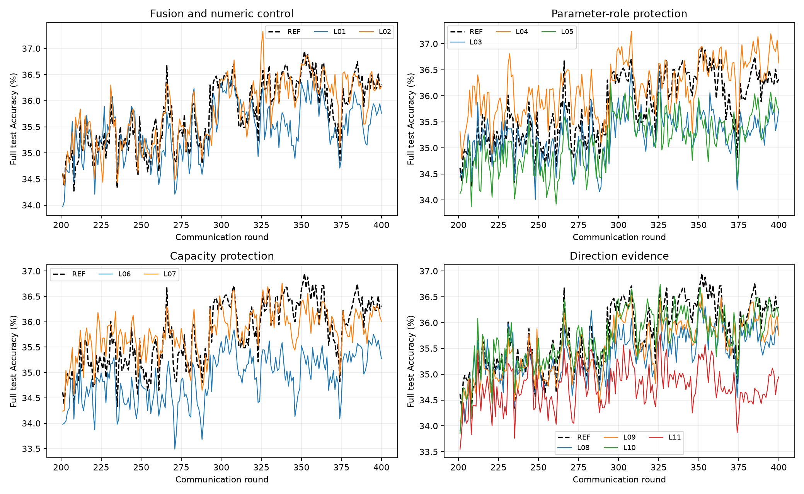

# 本地REF与L01–L11：400轮最终结果

**12组均完成400轮。排除代数等价对照L02后，L04是唯一同时提高本地REF峰值、Final、Last20和Last50的新机制；仅建议保留L04（分类器Native聚合）作为后续研究候选。L02与REF的数值轨迹明显不同，当前证据不足以宣称L04具有稳定、独立验证的优势。**

套件于北京时间2026年10月20日08:28:18结束，六批每批两个独立进程，全部成功，无OOM、重试、减batch或临时改公式。源代码冻结版本为 `975ccb1ac030cf9a937a60b589fe8539c97f7f36`；测试与启动证据见 `44a61f6b95fd642bdf4b609894c8886438d2f301`。

本地conda fd：`D:/software/minicoonda/envs/fd/python.exe`，PyTorch2.7.1+cu128，RTX4080 SUPER GPU0。数据：`C:/Users/admin/Desktop/submissioning/code/ori/AAAITMC_finish_need_code/data/cifar100`。结果：`runs/e03_local12_full400_seed1/`。原完整50000/10000数据、固定100客户端alpha0.3分区、七模型、10slots、4:3:3 available、seed1、SGD5epochs/batch50及原优化器参数、400轮与Full-only官方batch128/RNG隔离均保留。

实际12组的七档初始化和400轮客户端/模型调度一致，每组Full训练槽位均为587。主要比较对象是本地REF，未用服务器E03的37.29%判断本地优劣。

## 全部结果

Accuracy单位为%，差值为百分点。所有最高值标为官方测试集 **test-oracle peak**；并列取首次轮次。该指标不是独立验证集选择后的无偏性能。

|方法|test-oracle peak|轮次|Final|Last20|Last50|Final CE|Peak−REF|
|---|---:|---:|---:|---:|---:|---:|---:|
|REF|36.9500|352|36.3200|36.3545|36.2316|3.646787|+0.0000|
|L01|36.4500|358|35.7600|35.7465|35.7468|3.696317|-0.5000|
|L02|37.3300|326|36.2700|36.2130|36.2970|3.651217|+0.3800|
|L03|36.5200|308|35.7300|35.4500|35.3782|3.724490|-0.4300|
|L04|37.2400|308|36.6300|36.7505|36.6288|3.631186|+0.2900|
|L05|36.2500|295|35.7300|35.6760|35.4400|3.703373|-0.7000|
|L06|35.8400|308|35.2700|35.4295|35.2254|3.700040|-1.1100|
|L07|36.7600|338|36.0100|36.0465|36.0222|3.637655|-0.1900|
|L08|36.3100|350|35.7600|35.7450|35.7400|3.708712|-0.6400|
|L09|36.5700|352|35.7500|35.9885|35.9236|3.706965|-0.3800|
|L10|36.7400|326|36.1200|36.1195|35.9780|3.648637|-0.2100|
|L11|35.7800|326|34.9500|34.6950|34.7776|3.728890|-1.1700|

完整差值、Peak CE、固定峰值±2轮CE见[comparison.csv](evidence/e03_local12_results/raw/report/comparison.csv)。全部每轮值见[Accuracy CSV](evidence/e03_local12_results/raw/report/accuracy_all_rounds.csv)和[CE CSV](evidence/e03_local12_results/raw/report/ce_all_rounds.csv)。

## 必须先解释的中性对照

L02首轮严格原M2；第2轮起，其Native下发融合与M2下发融合在原七档同步下数学相同，故应与REF使用同一聚合规则。真实日志确认L02全部400轮相对自身同输入原M2的聚合差异L2均为0，第2–400轮399次下发前缀全部与Full锚点一致。

但两条实际轨迹并不相同：REF峰值36.95%，L02为37.33%，相差0.38pp；L02 Last20反而低0.1415pp、Last50高0.0654pp，Final低0.05pp。这不是L02的新机制收益。它表明本地同一数学算法、相同seed及初始/调度条件下存在运行间数值非复现性，与原本未强制确定性的CUDA训练路径一致。现有日志不能定位具体算子，也不足以只凭一个中性重复估计波动分布、置信区间或显著性。

L04峰值37.24%比REF高0.29pp，却低于中性L02的37.33%。因此仅凭最高单轮不能判定改进。L04的Last20/Last50分别高于REF 0.3960/0.3972pp，也高于L02 0.5375/0.3318pp；这是保留该方向的初步理由，主要对照仍按预定使用REF，不另换或池化基准。

## 各机制判断

### L01/L02：分离SGD权重主要是初始化对照

L01只在首轮改变实际聚合，相对同输入E03差异L2=.267010；第2–400轮差异严格为0。同步后不能把它描述成一种持续不同的SGD重加权算法。L01峰值低0.50pp、Last20低0.6080pp，未观察到Native下发融合的收益。结合L02的中性波动和服务器初始化对照，尚不能普遍断言原首轮融合一定必要或一定有害。停止将该等价后期规则作为独立新机制发展。

### L03/L04/L05：分类器保护是本轮唯一值得保留的候选

L03保留原方向评分，仅对真实BN affine用Native；L04仅对classifier用Native；L05同时保护二者。实际保护范围分别为10,048、51,300、61,348个Full参数，即0.08795%、0.44904%、0.53699%。逐轮记录的参数变化比例均未超出相应范围。

L04在221轮发生实际聚合改变。峰值+0.2900pp，Final+0.3100pp，Last20+0.3960pp，Last50+0.3972pp，Final CE降低.015602。L03的Last20/50低0.9045/0.8534pp；L05低0.6785/0.7916pp。结果不支持笼统保护所有BN/非卷积参数，而支持进一步审视分类器与特征参数是否应采用不同聚合权重。

L04第2–400轮相对同输入原M2的平均L2比为.9999921，平均聚合差异L2=.0003496，实际改变仅在分类器；其差异能量约99.85%位于原更新的垂直方向。该比例指差异向量的能量，并非全部更新能量。它不等价于对整模型施加一个全局步长倍率，但局部有效步长、方向以及首轮分类器融合仍同时变化，不能据此确定收益的唯一来源。

L04首轮差异L2=.037212，因此当前组也没有将“更合适的成熟阶段分类器聚合”与“更合适的初始分类器融合”完全拆开。它是参数类别分域聚合的探索候选，不是已验证的功能语义评分或可靠性机制。

### L06/L07：容量来源保护均未改善

L06按真实低能力物理ID0–39保护87个原负方向槽位，实际改变70轮聚合，峰值低1.11pp、Last20低0.9250pp。L07共有587个Full上传槽位，但其中只有35个原本为负方向，实际改变34轮；峰值低0.19pp、Last20低0.3080pp。不能将低容量或Full更新预设为应免受冲突判断的有益来源。L07干预较少，也不能据此证明所有容量保护设计必然无效；本轮固定版本不保留。

### L08/L09/L10：更改证据尚未带来收益

L08评分排除BN，仅改变5个风险符号，相对同输入M2的后续差异L2均值约.0000254，峰值仍低0.64pp。它不支持当前“BN方向是主要噪声”的假设；由于修改小而数值轨迹敏感，不能只据最终落后判定BN信息必然有益。

L09先等权平均有效特征/分类器余弦再取负风险，共1192/4000个负方向（29.80%），353轮非均匀权重、最小稳定权重.5493；风险符号改变822次。更均衡的分块权重产生更多冲突，却未超过REF：峰值低0.38pp，Last20低0.3660pp。参数量均衡本身没有证明判断更准确。

L10在共同交集排除自身物理客户端，使用物理客户端内及客户端间的两层中位数，共482/4000个负方向（12.05%），实际改变262轮聚合。权重更中性（最小.9142），峰值低0.21pp、Last20低0.2350pp，且服务器聚合计算开销增加。该固定鲁棒参考不作为优先候选。

这些评分替换还会改变独立初始化轮的整体模型融合，并未统一匹配首轮权重；不能把最终差异全部归因于成熟阶段冲突识别质量。

### L11：当前幅度有界风险明显落后

L11保持原方向与slot-LOO，只改变风险幅度。425个负方向记录中，新风险/原负余弦风险的平均比例为.6421，符合幅度不匹配时减轻惩罚的设计，214轮聚合实际改变。峰值低1.17pp、Last20低1.6595pp、Last50低1.4540pp，未支持当前幅度衰减规则。停止这个固定版本，不追加lambda或幅度系数搜索。

## 冲突与更新诊断

下表L2比均为第2–400轮、在各方法自己的同一批上传上对原M2的反事实比较，并非不同训练轨迹之间直接相除。负方向比例与实际权重变化是不同概念；L06/L07被保护槽位即使有负方向也可保持中性权重。

|方法|负方向slots/4000|非均匀权重轮数|平均稳定权重|实际偏离同输入M2轮数|后续平均L2比|
|---|---:|---:|---:|---:|---:|
|REF|420|205|0.996797|0|1.0000000|
|L01|435|220|0.996611|1|1.0000000|
|L02|444|225|0.996533|0|1.0000000|
|L03|414|221|0.996769|221|1.0000001|
|L04|423|221|0.996678|221|0.9999921|
|L05|408|213|0.996857|213|0.9999903|
|L06|427|193|0.997263|70|1.0010400|
|L07|440|213|0.996977|34|0.9997990|
|L08|424|214|0.996632|214|1.0000192|
|L09|1192|353|0.965218|353|0.9990267|
|L10|482|242|0.998265|262|1.0002871|
|L11|425|214|0.997763|214|1.0008249|

[机制CSV](evidence/e03_local12_results/analysis/mechanisms.csv)和[完整诊断JSON](evidence/e03_local12_results/analysis/extended_mechanisms.json)保留首轮/分期数据、参数范围、保护次数、证据符号变化和更新几何。不能把非零Gate、负方向或精确浮点不等直接解释为有效知识选择。

## 运行与核验

12组均通过真实400轮、latest.next_round/rows/CSV以及best首次峰值对齐核验，全组初始化/分区/实际调度相同。原始SGD、模型和聚合函数保持不变。每组独立日志、best/latest和最终状态均留在本地结果目录。没有追加训练或重新生成客户端更新。

单进程wall约78.77–92.94分钟；双进程六批总历时约8.6小时。单进程峰值allocated约1284–1396MiB，reserved约1486–1528MiB。L10服务器计算累计1492.58秒，REF为381.86秒；共享本地GPU环境下仅作为实测成本记录，不能直接比较Linux性能。详见[costs.csv](evidence/e03_local12_results/analysis/costs.csv)。

启动前94项必要检查通过。本次只修改离线报告排名，明确从新机制候选中排除等价L02，并新增只读日志分析；报告/几何回归3项通过。原始训练源码及配置未改，未用官方测试集在线调参。权重留在本地，不提交大checkpoint或私人资料。

## 最终推荐与停止

1. 仅推荐L04分类器保护作为下一步研究候选：它在主要本地REF对照下四个Accuracy指标均改善，且末段均值也超过中性L02。但其峰值增量小于本次中性重复的峰值差，仍不能宣称稳定泛化优势。
2. 继续保留原M2/REF作基准；L02保留为数值一致性证据，不能作为新机制。没有第二个新候选获得足够支持。
3. 当前BN/联合保护、容量免罚、排除BN评分、等权分块、鲁棒中位数和幅度衰减固定版本停止扩展，不再临时调参或添加方法。
4. 若后续继续科学验证，优先弄清数值重复性并隔离分类器首轮融合与后续聚合，而不是扩展Q、Memory或更多超参。本轮不执行这些新实验。

全部峰值为单种子官方测试探索结果，12组比较亦存在候选选择效应；400轮不是400个独立统计重复。本任务完成后停止，等待后续授权。
