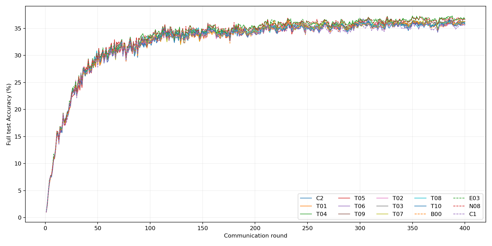
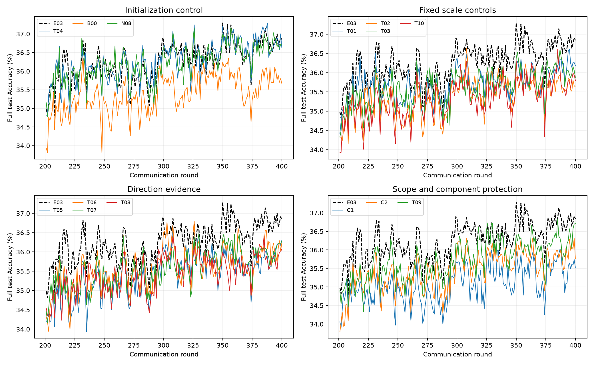
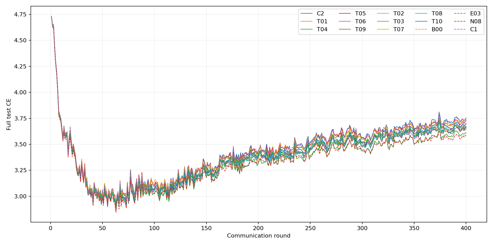

# E03固定十组400轮：服务器最终结果

**没有新组超过E03的37.29% test-oracle peak。T04追平37.29%，末段均值略高；其余T组和C1/C2均落后。保留E03作为最强方向聚合参考，T04作为初始化控制。本轮没有新的机制得到足以替代E03的性能支持。**

北京时间2026年10月20日06:43:21，服务器C2重跑及T01–T10共11组全部成功完成400轮，无失败、重试或临时调参。GPU0严格串行，累计训练进程wall约7.07小时。C1既有400轮结果及B00/E03/N08历史结果只读复用。

训练项目：`/home/hh/TMC_re_e03_scope_components400_20261019`；结果根：`runs/e03_tonight10_400_seed1/`。冻结训练源码：`7577f422e92f3b7490785b10c210b6515d098156`。conda hh，PyTorch2.7.1+cu118，RTX4090 GPU0。

全部使用原七档、原CIFAR100 alpha0.3分区、100客户端/10 slots、4:3:3 available、seed1、本地SGD5epochs/batch50、原学习率及衰减、400轮和Full-only官方测试。C1/C2/T全部12条实际轨迹的七档初始化与400轮客户端/模型调度一致，初始化也与历史E03相同，原聚合源码一致。独立CUDA进程保留原有非确定性，不能宣称历史轨迹bitwise一致。

## 完整结果

Accuracy单位为%，差值为百分点。Peak全部是官方测试集 **test-oracle peak**，并列峰取首次轮次；它不是独立验证集选择的无偏性能。

|方法|test-oracle peak|轮次|Final|Last20|Last50|Final CE|相对E03峰值|
|---|---:|---:|---:|---:|---:|---:|---:|
|B00|36.4000|232|35.6700|35.8320|35.7084|3.740723|-0.8900|
|E03|37.2900|350|36.8400|36.7885|36.6946|3.666226|+0.0000|
|N08|37.1800|357|36.7000|36.7085|36.6558|3.582589|-0.1100|
|C1|36.0200|387|35.5300|35.5650|35.4244|3.743544|-1.2700|
|C2|36.3200|308|35.7600|35.8935|35.8122|3.753516|-0.9700|
|T01|36.6100|395|36.1900|36.1680|35.9560|3.653426|-0.6800|
|T02|36.6400|308|35.6300|35.6875|35.6548|3.695007|-0.6500|
|T03|36.6000|387|35.8800|36.1210|35.9894|3.675725|-0.6900|
|T04|37.2900|388|36.6300|36.8410|36.7704|3.612657|+0.0000|
|T05|36.6800|308|36.3000|35.8965|35.7560|3.726218|-0.6100|
|T06|36.8000|326|36.2300|36.1025|35.9038|3.642075|-0.4900|
|T07|36.4900|330|36.2800|36.0205|35.9776|3.701662|-0.8000|
|T08|36.4200|308|36.0800|35.9040|35.7182|3.668250|-0.8700|
|T09|36.8300|385|36.7100|36.2905|36.1516|3.657138|-0.4600|
|T10|36.6000|385|35.8000|35.8305|35.7144|3.697380|-0.6900|

完整Peak CE、固定峰值±2轮CE及每轮数据见[comparison.csv](evidence/e03_tonight10_results/raw/report/comparison.csv)、[400轮Accuracy](evidence/e03_tonight10_results/raw/report/accuracy_all_rounds.csv)、[400轮CE](evidence/e03_tonight10_results/raw/report/ce_all_rounds.csv)。各方法原始日志、manifest、完成记录与资源记录均位于证据raw对应方法目录。

## 固定设定与结果含义

|组别|固定设定|本轮判断|
|---|---|---|
|T01|E03之后按原M3静态shared/remainder对总更新用1/.98尺度|峰值36.61，低于E03；未显示方向与区域尺度的净互补收益|
|T02|E03相对Full锚点的整体更新乘.98|峰值36.64，但末段较差；不能用缩步长解释成更优算法|
|T03|仅原M2出现负余弦轮执行T01|211轮触发，峰值36.60；没有优于无条件T01|
|T04|首轮原生AdaptiveFL，第2–400轮严格原M2|追平峰值，Last20/50略高；保留为初始化控制|
|T05|同公共交集，排除自身全部物理slot，其他客户端平均视图只计一次样本质量|真实改变了身份参考，未改善性能|
|T06|不同物理客户端真实成对交集上的加权直和余弦，整体上传重权|同时改变支持与汇总规则，权重更中性，未超过E03|
|T07|只用公共classifier参数评分，整体上传重权|冲突大幅增多、权重更强，精度仍落后|
|T08|只用公共非classifier参数评分，整体上传重权|更接近原证据，但没有增益；包含原BN affine|
|T09|保留E03整体门控和融合，仅在E内恢复被压低负冲突槽位的剩余分量|恢复实际生效，但峰值和后期均值均未超过E03|
|T10|保留E03，只将E外真实SGD学习项乘.98，不缩放下发融合|未显示动态证据边界与学习尺度的净收益|

原公式、支持与物理身份处理见[固定设计](E03_TONIGHT10_DESIGN.md)。T01/T03缩放相对Full的总位移，T10只缩放实际SGD；两者不仅是区域掩码不同。T06的直和成对余弦也不是先平均方向再计算余弦，不能把差异全部归因于支持更充分。

### T01/T02/T03/T10：没有得到可保留的尺度协同

T01比T02峰值低0.03pp，但Last20高0.4805pp、Last50高0.3012pp，说明两种尺度控制的后期行为不同；两者仍均落后E03。T03比T01峰值低0.01pp、Last20低0.0470pp，按冲突触发没有带来额外优势。T10比T01峰值低0.01pp、Last20低0.3375pp；保留首轮融合的T10同样落后，因此不能把全部退化都归于缩小独立初始化融合。

第2–400轮相对同输入E03的平均更新L2比：T01=.988576，T02=.980000，T03=.994339，T10=.989038。T02近乎纯全局缩放；T01/T03/T10的变化还含区域方向成分。数值上它们确实不同，但没有观察到超过E03的收益，不支持将这些固定尺度组合保留为新核心。

### T04：首轮融合不构成E03优势的必要解释

T04首轮相对同输入E03的实际差异L2=.302450；原生首轮总位移L2=44.450084，同输入E03为44.493277，包含独立初始化模型融合，不能全称SGD增量。第2–400轮相对同输入E03的差异L2严格为0，更新L2比与余弦均为1。

T04在388轮达到37.29%，E03在350轮达到37.29%；T04 Final低0.2100pp，Last20高0.0525pp、Last50高0.0758pp，Final CE降低约.05357。它没有全面占优，也没有超过峰值。可以确认保留原M2首轮加权融合不是达到本次37.29%的必要条件；不能据单条轨迹确认稳定改进，或将首轮影响与原有CUDA非确定性完全分离。

### T05/T06：身份和覆盖比较更明确，没有转化为精度收益

固定调度有165/400轮存在重复物理客户端slot。T05在自身同一批上传上，原slot-LOO有413个负余弦，新参考有461个，80/4000个风险符号改变；相对同输入E03实际改变93轮聚合。物理去重不是没有生效，但峰值低0.61pp、Last20低0.8920pp。

T06的同输入原M2有404个负方向，新得分406个，158个风险符号改变；实际改变220轮聚合。稳定权重均值.999066、最小.949718，明显偏中性。这是比较/汇总方式的变化，不等于更准确地识别有害更新；峰值低0.49pp，Last20低0.6860pp。当前数据不支持用T05/T06替换原评分。

### T07/T08：更多冲突不等于更有效

T07有1328/4000个负余弦（33.20%），358/400轮出现非均匀权重，最小稳定权重.337784；T08为360/4000（9.00%）、194轮、最小.867419。T07相对其自身上传的原M2改变971个风险符号，T08为90个。只用分类器使干预明显增强，却没有超过E03；T07/T08峰值分别36.49/36.42%，不足以支持某一类证据单独最优。

### C1/C2/T09：实际分量保护未证明性能收益

C1峰值36.02%，C2为36.32%；T09保留E03交集外整体门控后升至36.83%，但仍低于E03 0.46pp，Last20低0.4980pp、Last50低0.5430pp。T09与C2同时存在投影/剩余分母和交集外处理差异，不能把提升单独归因于某一因素。

C2确实在209轮调整423个负投影槽位。原自动报告的protected_components字段只对应T09列表，C2不写该字段，不能把其0解释为C2未激活；本次离线汇总新增独立C2计数，训练未变。T09在215轮恢复373个负冲突槽位，其他负冲突槽位并未被原归一化系数压低，不强制恢复。

T09恢复的平均系数为.0026512；被恢复槽位在交集内的剩余分量平均占更新能量99.9874%，不等于这些能量具有语义收益。实际Full参数与同输入E03不等的比例按全部轮平均为10.21%，只是数值变化比例。恢复范数满足预定三角界，最大数值超出仅8.7e-19，属float64舍入，没有异常放大。

T09后续更新L2平均为同输入E03的1.001329倍，方向余弦平均.9999796；恢复发生了可观测的方向变化，却未改善基准表现。这支持停止当前固定版本的分量保护，而不是继续通过调系数制造收益。

## 更新尺度与因果范围

全部同输入E03比较，均是在各候选自己的真实上传上调用原M2得到的反事实；它不是重跑的历史E03轨迹。由日志的范数和内积，将差异分为沿E03方向的尺度项与垂直项，仅作几何解释，不额外评估或改变模型。

T02差异能量几乎全是尺度项；T01/T03/T10的垂直差异能量约30.3%/34.0%/31.5%，T05/T06/T07/T08/T09约89.6%–94.1%。后者指“差异向量”的能量，不是全部更新能量：它们的总更新余弦仍很接近1。

因此，T09等修改在代数上不等价于一个纯全局学习率倍率；但没有收益可据此归因。未进行额外匹配范数训练、随机种子或性能实验，不能证明方向与尺度各自的唯一因果贡献。

## 成本、核验及文件

新11组每组wall约37.83–40.85分钟；单进程峰值allocated约1282–1563MiB，reserved约1446–2042MiB，全部完成且无OOM。T06服务器计算累计217.49秒，T04为45.71秒，总wall约多7%；共享GPU环境下这些是实测开销，不是独立硬件性能基准。详见[costs.csv](evidence/e03_tonight10_results/analysis/costs.csv)。

服务器原队列已逐组检查真实400轮、latest.next_round/rows/CSV以及best对应首次峰值，最终报告也校验全组配对。原始checkpoint保留服务器；本地/GitHub保存CSV、诊断、manifest、完成及资源记录，没有上传大权重或私人论文。旧C2按用户要求在114轮中断的记录保留，新C2是fresh seed1重跑，不冒充续训。

启动前Linux92项检查通过；本次仅修正和扩展离线统计与图表，7项报告/几何及共享绘图回归检查通过，没有重训。原自动汇总原样保留于raw/report，新增分析位于analysis；原始数值文件不覆盖。

[机制总表](evidence/e03_tonight10_results/analysis/mechanisms.csv) · [详细机制与核验](evidence/e03_tonight10_results/analysis/extended_mechanisms.json) · [测试日志](evidence/e03_tonight10_results/report_tests.log)

## 最终保留与停止

1. 保留E03作为最强方向聚合参考。T04只保留为初始化控制，其追平峰值和微小末段差异不构成新的SemConsFL贡献。当前没有新候选足以替代E03核心。
2. 本轮固定版本的M2+尺度组合、物理/成对替换参考、单独分类器/特征评分及分量保护均不继续无目的调参；这不等于否定所有相关理论方向。
3. 尚不能把E03收益唯一归因于方向证据、覆盖传播、步长或某类互补知识。实验支持“简单作用域收缩/更多冲突/分量恢复未带来更强结果”，不支持功能语义机制已被验证。
4. 本服务器任务完成后停止，无新400轮、种子、Q或Memory。本地REF/L系列由独立任务以本地REF为基准另行汇总。
