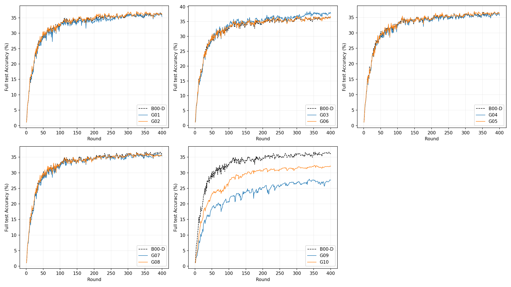
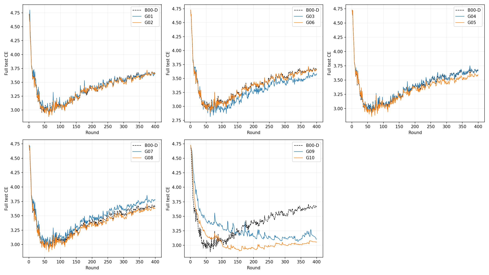
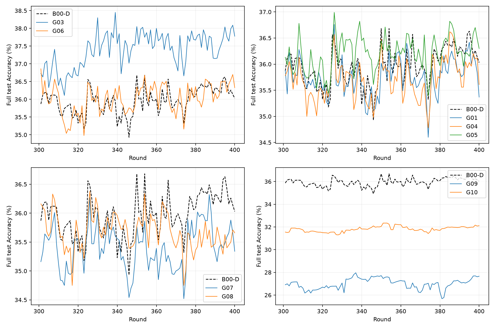
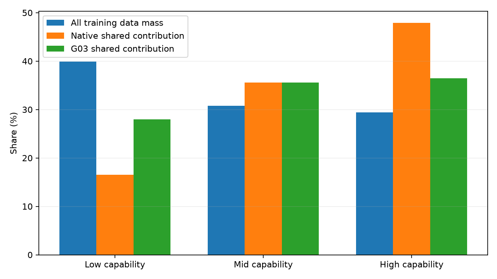

# Native AdaptiveFL十组400轮结果与研究决策

G01–G10均真实完成400轮，五批各两进程在服务器GPU0运行，于北京时间2026年10月20日22:31结束；无失败、重试、参数调整或追加训练。完成检查任务已暂停。复用原有B00-D，不重跑基线。

**首选保留G03能力层级来源均衡，次选低优先级保留G05部分共享额外区域的模型档位均衡。** G03的Full test-oracle peak为38.45%，Last20为37.6585%，相对确定性B00-D分别增加1.77和1.3395个百分点；Final和Last50也改善。G05四项Accuracy改善均较小。当前累计覆盖补偿和离散度收缩方案没有得到支持，不继续本轮调参。

## 1. 固定条件与运行证据

唯一服务器项目：`/home/hh/TMC_re_e03_scope_components400_20261019`。

结果根：`runs/native_groups10_full400_seed1/`，各组为`gXX/GXX_full_only_400_seed1_deterministic/`，保存原日志、latest.pt、best_full.pt及完成标记。

训练源码冻结提交：`36b84b858b6a03c038ad8a142ededf870c5b5ce6`。本次收尾仅增加离线分析、证据和报告，不修改冻结训练算法。

七个原始ResNet、完整CIFAR-100、原缓存Dirichlet α=0.3分区、100客户端、10 slots、5 local epochs、batch50、seed1、400轮及原SGD均保留。每轮聚合后同步七模型，只测试P6 Full，评估隔离RNG。统一Torch2.7.1+cu118、RTX4090 GPU0，确定性算法开启、cuDNN deterministic开启/benchmark关闭、TF32关闭、CUBLAS_WORKSPACE_CONFIG=:4096:8，与B00-D一致。

五批依次为G01/G02、G03/G06、G04/G05、G07/G08、G09/G10。没有额外客户端计算或通信。每组真实Full训练587个slot；400轮调度相同，其中165轮含重复物理客户端。第1轮全部严格Native，首轮Full Accuracy及CE与B00-D一致，从第2轮启用对应方法。

服务器直接读取checkpoint验证：十组latest均为400轮、400条评估记录，Full参数形状一致且有限；best对应CSV中的首次峰值轮次；全部训练源码指纹相同。离线再次核对初始化、分区/训练与确定性设置、全部实际slot调度、九区域覆盖计数、未覆盖保护、G04/G05作用范围。权重保留服务器，Git只保存原始标量证据。

## 2. 十组设定

完整固定公式见[NATIVE_GROUPS10_DESIGN.md](NATIVE_GROUPS10_DESIGN.md)，配置见[JSON](../configs/native_groups10_400.json)。以下均从Native覆盖归一化出发，首轮Native。

| ID | 第2–400轮服务器规则 |
|---|---|
| G01 | 每区域按实际模型档位分组，组内原样本加权、实际参与档位间等权 |
| G02 | 每区域合并同一物理客户端的重复slot，原数据量只计一次；SGD上传仍独立 |
| G03 | 按物理客户端原4:3:3能力层分组，组内Native样本-slot权重、参与能力层间等权 |
| G04 | G01仅作用于静态七模型共同覆盖区域 |
| G05 | G01仅作用于共同区域补集；无上传仍不更新 |
| G06 | 每坐标实际覆盖slot等权，不使用样本量权重 |
| G07 | 九区域累计去重物理覆盖次数，平方根反比补偿，倍率限[0.8,1.2] |
| G08 | 同批上传只读计算虚拟G07，然后统一缩放Native更新以匹配其整体L2 |
| G09 | 物理客户端块的加权区域均值/离散度估计，非负信号与均值噪声形成固定Wiener收缩；单客户端Native |
| G10 | 同批上传只读计算虚拟G09，然后统一缩放Native更新以匹配其整体L2 |

## 3. 全部性能结果

Accuracy单位为%，差值单位为百分点。Peak均为官方测试集每轮评估得到的 **test-oracle peak**，不是独立验证集选出的无偏性能。CE为第400轮Full交叉熵。

| 方法 | test-oracle peak | 轮次 | Final | Last20 | Last50 | Final CE | ΔPeak | ΔLast20 |
|---|---:|---:|---:|---:|---:|---:|---:|---:|
| B00-D | 36.6800 | 350 | 36.0300 | 36.3190 | 36.1154 | 3.672783 | — | — |
| G01 | 36.7600 | 326 | 35.3700 | 35.9945 | 35.8530 | 3.660246 | +0.0800 | −0.3245 |
| G02 | 37.1100 | 326 | 36.0000 | 36.2425 | 36.2056 | 3.660577 | +0.4300 | −0.0765 |
| **G03** | **38.4500** | **339** | **37.7800** | **37.6585** | **37.6056** | **3.587194** | **+1.7700** | **+1.3395** |
| G04 | 36.6200 | 385 | 35.6100 | 36.0490 | 35.7940 | 3.663546 | −0.0600 | −0.2700 |
| **G05** | **36.9900** | **326** | **36.3000** | **36.3890** | **36.2874** | **3.592922** | **+0.3100** | **+0.0700** |
| G06 | 36.8600 | 301 | 36.3300 | 36.2805 | 36.1750 | 3.666775 | +0.1800 | −0.0385 |
| G07 | 36.3200 | 387 | 35.3400 | 35.6890 | 35.4410 | 3.778043 | −0.3600 | −0.6300 |
| G08 | 36.3800 | 326 | 35.6600 | 35.5515 | 35.6206 | 3.628957 | −0.3000 | −0.7675 |
| G09 | 27.9600 | 337 | 27.6600 | 27.0710 | 27.0016 | 3.106663 | −8.7200 | −9.2480 |
| G10 | 32.3400 | 351 | 32.1100 | 31.9830 | 31.9252 | 3.055738 | −4.3400 | −4.3360 |

G01、G02、G03、G05、G06超过基线峰值，但只有G03、G05同时超过基线Final、Last20和Last50。G02不能只凭37.11%的单轮峰值进入优先候选。G09/G10的CE较低，却伴随明显较差的Top-1 Accuracy，不能将低CE单独解释为学习改善；本轮没有保存预测分布来进一步区分置信度或校准效应。

完整400轮曲线：





末100轮固定机制对照：



## 4. 来源均衡：G03最值得保留

原缓存训练分区中，低/中/高能力物理客户端分别拥有19,931/15,373/14,696个样本，占39.862%/30.746%/29.392%。原采样和资源约束保持不变，但第2–400轮公共区域的Native贡献份额均值为16.5565%/35.5676%/47.8759%，明显偏向高能力来源。

G03将公共区域的能力层贡献份额改为27.9449%/35.5890%/36.4662%。这是对每轮**实际参与**能力层等权后的跨轮均值；某层缺席时不凭空贡献，因此不要求最终均值恰好各1/3。G01按模型档位等权后的低/中/高份额约16.4850%/34.8908%/48.6242%，并未纠正物理来源失衡。G02、G06对该失衡改变较小。



G03相对G06的Peak/Final/Last20/Last50分别高1.59/1.45/1.3780/1.4306个百分点，支持收益不只是取消样本量权重。G02在164轮实际改变聚合，165个重复客户端轮次中的首轮因统一Native不干预；重复slot不是唯一问题。G03在398轮改变聚合，作用涉及公共及部分共享区域，Full-only区域因只有Full档位且只来自高能力层，其聚合相对同输入Native始终不变。

**得到支持的解释：原资源约束下的物理客户端来源贡献不均衡值得研究。** 本轮没有证明低能力更新天然更好、高能力更新有害，也没有将能力层、客户端身份和Non-IID类别分布的效应完全分离。更不能将来源均衡称为已经验证的功能语义可靠性。

## 5. 作用范围：G05优于G01/G04，但增益较小

G05相对G01的Peak/Final/Last20/Last50分别增加0.23/0.93/0.3945/0.4344个百分点；相对G04增加0.37/0.69/0.3400/0.4934。对全部公共区域强行模型档位均衡没有收益，避开公共区后结果较好。

需要准确界定G05的作用：九区域中，公共区2,120,985参数，Full-only区4,478,775参数；Full-only只有一个模型档位，G01/G05在那里都直接等价Native。G05的实际修改发生在其余七个**部分共享的额外区域**，不是直接给Full-only参数增加权重。它支持有限的覆盖作用域差异，但相对B00-D的Last20仅提高0.0700个百分点，证据弱于G03，不宜据此宣称稳定优势。

## 6. 覆盖补偿与离散度收缩：当前固定方案停止

所有组的九区域累计独立物理覆盖次数相同，依次为3797、3259、2743、2735、2214、1681、2188、1121、571。G07/G08的逐轮累计状态也相同；统计确实反映Full-only覆盖较少，没有对未覆盖参数制造更新。

G07公共区域第2–400轮全部触及0.8下限，两个最低覆盖区域在有上传时触及1.2上限；Full-only实际329个后续轮次收到上传并被补偿。算法确实激活，但“覆盖少所以需要更大更新”没有得到Accuracy支持。G07相对G08的Peak/Final/Last20/Last50差值为−0.06/−0.32/+0.1375/−0.1796个百分点，没有一致的结构补偿收益。尽管局部有放大，G07整体更新L2均值比约0.9227，并非总体放大学习步长。

G09公共区的均值噪声估计与观测均值能量之比均值约0.934，收缩系数均值仅0.0771，83个后续轮次将该区域系数置零。全覆盖坐标加权后，区域系数均值约0.2210，零系数坐标占比均值16.57%。Full-only的329个覆盖后续轮次中，157轮只有一个物理客户端，正确保持Native；其他区域的有效收缩仍很强。真实Non-IID更新间的离散性不能直接等同于需要消除的噪声，当前估计过度削弱了学习。

G09相对其整体尺度对照G10的Peak/Final/Last20/Last50分别低4.38/4.45/4.9120/4.9236个百分点。G10自身也远低于Native，说明本次强收缩造成的总体更新减弱和区域性收缩均未体现价值。该结果针对当前固定估计方案，不据此声称所有区域可靠性研究都无效；本任务不修改公式继续尝试。

## 7. 更新尺度与因果边界

以下比较均针对每组**自身轨迹、相同上传与Full锚点**的Native反事实，不是与历史B00-D逐轮模型直接相减。均值使用第2–400轮，排除独立初始化融合。

| ID | 实际改变轮数 | 平均实际/Native更新L2比 | 平均差异L2 | 修改是否仅为全局尺度 |
|---|---:|---:|---:|---|
| G01 | 399 | 1.06690 | 0.16308 | 否 |
| G02 | 164 | 1.01250 | 0.03491 | 否 |
| G03 | 398 | 1.18635 | 0.21072 | 否 |
| G04 | 399 | 1.04318 | 0.10677 | 否 |
| G05 | 399 | 1.03352 | 0.11692 | 否 |
| G06 | 399 | 0.96141 | 0.06304 | 否 |
| G07 | 399 | 0.92273 | 0.07005 | 否，逐区域补偿 |
| G08 | 399 | 0.92097 | 0.02681 | 是，同输入虚拟G07尺度 |
| G09 | 399 | 0.25828 | 0.58805 | 否，逐区域收缩 |
| G10 | 399 | 0.19752 | 0.45342 | 是，同输入虚拟G09尺度 |

由保存的更新/差异范数重建，G03相对同输入Native的**差异能量**约95.78%垂直于Native更新，G05约93.46%；这说明不是代数意义的统一缩放，不等于已经证明Accuracy收益独立于尺度变化。G03整体L2也增加约18.64%，且本轮没有G03自身的全局范数匹配对照，因此不能排除有效更新幅度对收益的贡献。本任务不追加对照实验。

G08/G10的区域gain日志是只读**虚拟**区域系数，实际执行的是global_scale，不能把虚拟零系数当作真实局部门控。二者每轮只匹配各自上传上的虚拟方案，G07和G08、G09和G10后续模型不同，不能要求跨进程逐轮范数相等。

实际尺度匹配最大相对误差：G08约5.74e−8；G10约1.1095e−4（0.0111%），出现在第127轮，目标L2=0.0001026413，实际L2=0.0001026527，绝对误差1.14e−8。该差异来自float32模型写回量级，不能误报为严格零误差；其大小不足以解释数个百分点的Accuracy退化。原算法未因此修改或重训。

## 8. 运行成本

| ID | 进程墙钟分钟 | 400轮服务器秒数合计 | 峰值allocated MiB | 峰值reserved MiB |
|---|---:|---:|---:|---:|
| G01 | 74.82 | 72.37 | 1098.17 | 1252 |
| G02 | 74.82 | 73.29 | 1098.17 | 1252 |
| G03 | 74.89 | 75.73 | 1098.17 | 1252 |
| G04 | 77.01 | 81.11 | 1098.17 | 1252 |
| G05 | 77.01 | 79.87 | 1098.17 | 1252 |
| G06 | 74.89 | 76.01 | 1098.17 | 1252 |
| G07 | 90.98 | 275.71 | 1402.83 | 1484 |
| G08 | 90.98 | 283.27 | 1397.89 | 1484 |
| G09 | 77.70 | 157.48 | 1402.83 | 1484 |
| G10 | 77.71 | 159.02 | 1397.89 | 1484 |

时间来自实际双进程共享GPU0，不是独占硬件速度基准。G07/G08实际服务器及墙钟开销较高；不能把跨批墙钟差全部归因于算法。原始逐轮训练、服务器和评估时间保存在CSV中。

依据真实4000个slot与七模型参数数目、float32每参数4字节，各组上行88,387,695,816字节、下行同量，不含传输头/序列化开销。新方法没有新增客户端计算、反馈或通信。G07只维护九个累计整数，G09不保存历史更新或语义Memory。

## 9. 最终科研决策

1. **G03优先保留。** 峰值、Final和末20/50均改善，来源份额与实际聚合变化有明确证据，最值得研究的是异构资源约束下的物理来源贡献失衡及其覆盖内归一化。
2. **G05作为次选保留。** 支持在部分共享额外区域平衡模型档位，避免对全部公共区统一操作；增益小，优先级明显低于G03。
3. G02/G06仅有混合小幅结果，不作为额外核心候选；G01/G04公共区档位均衡、G07/G08当前机会补偿、G09/G10当前离散度收缩没有提供足够支持，停止本轮固定方向的继续调参。

这些是一个seed、同一个官方测试集反复观察得到的探索结论。不能把38.45%的test-oracle peak当作独立泛化证明，也不能称G03已完成论文统计验证或语义机制验证。没有根据测试结果在线调整任何公式、倍率、实验顺序或追加种子；十组完成后停止。

## 10. 文件、复核与交付

- [原始证据目录](evidence/native_groups10_results/)：各组逐轮Accuracy/CE、原始诊断、manifest、summary、completed、资源和服务器checkpoint核验。
- [统一结果CSV](evidence/native_groups10_results/analysis/comparison.csv)、[九区域统计](evidence/native_groups10_results/analysis/regions.csv)、[来源权重](evidence/native_groups10_results/analysis/shared_source_weights.csv)、[分析JSON](evidence/native_groups10_results/analysis/analysis.json)。
- [400轮Accuracy CSV](evidence/native_groups10_results/report/accuracy_all_rounds.csv)、[CE CSV](evidence/native_groups10_results/report/ce_all_rounds.csv)。
- 启动前本地/Linux专项93 tests通过；真实七形状合成GPU正确性/显存检查通过，均有启动证据。完成后新增结果/差异几何回归，结果见`evidence/native_groups10_results/report_tests.log`。

离线复核命令（新输出目录，避免覆盖原报告）：

```bash
python tools/analyze_native_groups_results.py \
  --root docs/evidence/native_groups10_results \
  --output /tmp/native_groups10_analysis
```

该工具只读取已保存标量和原训练分区索引，不读取训练图像或官方测试集构造新评分，不创建模型、SGD或新训练任务。至此本批结束。
