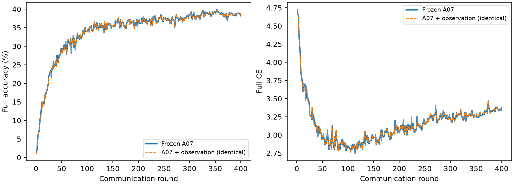
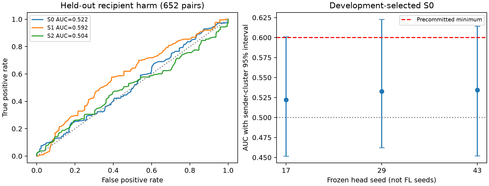

# 最终结果：No-Go，保留冻结A07

|运行|test-oracle peak|轮次|Final|Last20|Last50|Final CE|
|---|---:|---:|---:|---:|---:|---:|
|历史A07|39.9400%|353|38.2100%|38.6235%|38.6440%|3.375808|
|A07+三头纯观测，本次400轮|39.9400%|353|38.2100%|38.6235%|38.6440%|3.375808|

400轮Accuracy、CE及调度完全一致，测量没有改变A07，也没有产生新的性能提升。峰值是官方测试集逐轮评价的探索性test-oracle peak。

3996个真实训练侧反事实配对、226对负LOO；有效开发140对、确认652对。预选S0确认AUC0.52225、增量MSE改善−0.0280%；S1 AUC0.59187但增量−22.6623%；S2 AUC0.50448、增量+1.7832%。全部未通过冻结Go。S2 Anchor有有限回归增量迹象，但不能替代整个四阶段验证；Reliability预测未通过且存在明显support外推限制。

**停止正式语义Gate及多seed训练，保留A07，不继续搜索当前Prototype评分。** 观测软件、真实2/20回归、400轮观测完成；机制Go、语义性能提升和论文级四阶段证据均未成立。

完整解释见SEMCONS_A07_MECHANISM_VALIDATION.md，最终审计见SEMCONS_A07_FINAL_AUDIT.md。证据目录docs/evidence/semcons_a07/final包含CSV、来源/完成/资源、原始配对gzip、SHA索引、聚类统计及本地重算核验。

