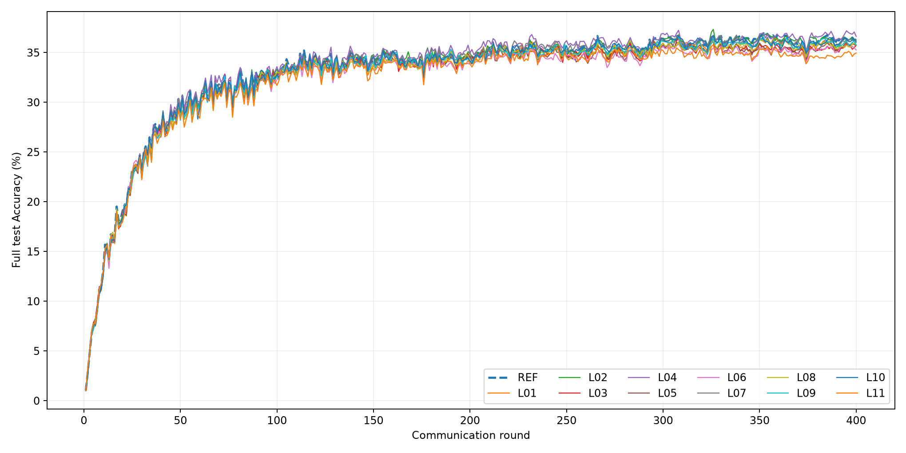
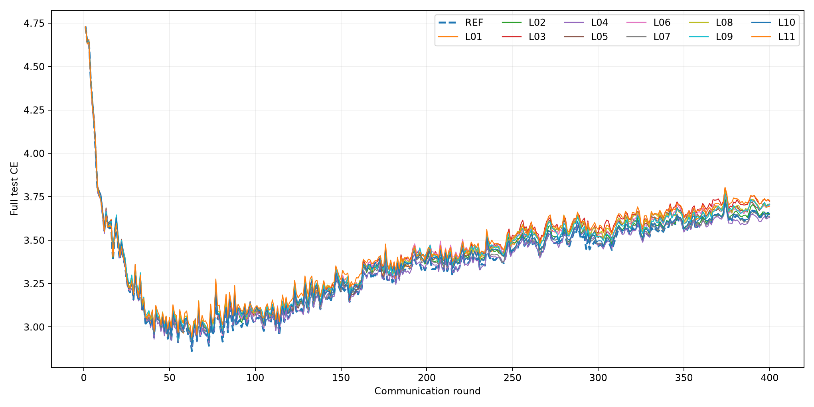

# 本地E03参考与11组固定机制实验

全部12组完成400轮、seed1。主要对照为本地REF，不以Linux E03的37.29%作为优劣判据。峰值均为官方测试集test-oracle peak；单种子探索不等于独立验证的泛化优势。

|方法|test-oracle peak %|轮次|Final %|Last20 %|Last50 %|Final CE|Peak−REF pp|
|---|---:|---:|---:|---:|---:|---:|---:|
|REF|36.9500|352|36.3200|36.3545|36.2316|3.646787|+0.0000|
|L01|36.4500|358|35.7600|35.7465|35.7468|3.696317|-0.5000|
|L02|37.3300|326|36.2700|36.2130|36.2970|3.651217|+0.3800|
|L03|36.5200|308|35.7300|35.4500|35.3782|3.724490|-0.4300|
|L04|37.2400|308|36.6300|36.7505|36.6288|3.631186|+0.2900|
|L05|36.2500|295|35.7300|35.6760|35.4400|3.703373|-0.7000|
|L06|35.8400|308|35.2700|35.4295|35.2254|3.700040|-1.1100|
|L07|36.7600|338|36.0100|36.0465|36.0222|3.637655|-0.1900|
|L08|36.3100|350|35.7600|35.7450|35.7400|3.708712|-0.6400|
|L09|36.5700|352|35.7500|35.9885|35.9236|3.706965|-0.3800|
|L10|36.7400|326|36.1200|36.1195|35.9780|3.648637|-0.2100|
|L11|35.7800|326|34.9500|34.6950|34.7776|3.728890|-1.1700|

排除代数等价中性对照L02后，新机制最高观察峰值：L04，37.2400%；是否超过本地REF：是。
非中性新机制最高Last20：L04，36.7505%；REF Last20为36.3545%。

L02在原全七档同步后与REF代数等价，是数值一致性对照，不构成新机制；CUDA独立进程可能存在原有非确定性。
L01隔离的主要是首轮独立初始化融合。L03/L04/L05保护的参数类由真实模块识别；L06保护物理能力ID，L07保护实际Full槽位，两者不是同一划分。
L09先等权平均有效分块余弦再取负风险。L10对其他物理客户端内的有效slot余弦取中位数，再对不同客户端中位数取中位数；不同物理客户端不重复计数。
机制日志的E03更新比较使用各方法自身上传，不是额外重跑REF轨迹。首轮融合与第2–400轮L2分开统计，不能仅凭峰值或Gate触发认定有效。

